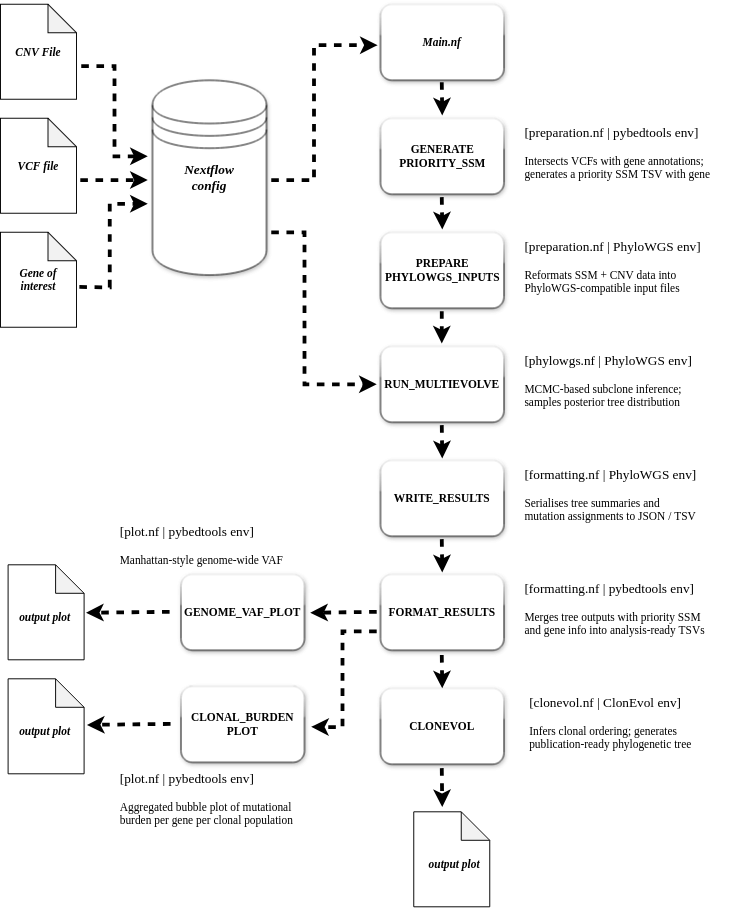
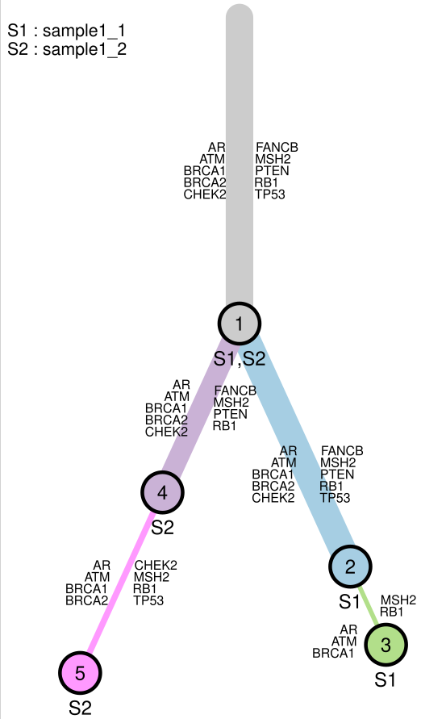

# 🧬 nf-tumor-clonality

<div align="center">


**A scalable Nextflow DSL2 pipeline for tumor subclonality analysis.**  
Automated data engineering via Python · Multi-Conda-environment Dockerization · phylogenetic reporting.

</div>

---

## Overview

This repository hosts a **production-ready Nextflow DSL2 pipeline** that automates the full workflow of tumor subclonality analysis — from raw somatic variant calls and copy number data through to phylogenetic tree reconstruction and final reporting.

The pipeline integrates legacy computational tools (PhyloWGS, ClonEvol) with modern workflow orchestration and containerization, directly addressing the **reproducibility crisis** common in cancer phylogenetics. A single Docker image (`divinwilson/nf_clonality:v1`) hosts multiple isolated Conda environments, with each pipeline stage injecting the correct environment's `PATH` at runtime — a practical engineering solution to deep dependency conflicts between Python 2, Python 3, and R toolchains.

---

## Key Features

| Feature | Description |
|---|---|
| **Nextflow DSL2** | Modular workflow with clean module imports and channel-based data flow |
| **Python Data Engineering** | Custom scripts for SSM prioritisation, input formatting, and result parsing |
| **Single-Image, Multi-Env Docker** | One image hosts `pybedtools`, `PhyloWGS`, and `ClonEvol` Conda envs — activated per-process |
| **Reproducible Reporting** | Automated clonality trees and mutation assignment tables via R (ClonEvol) |
| **Gene-of-Interest Tracking** | Priority SSM file generation flags user-defined genes throughout the workflow |
| **Resume Capability** | Nextflow caching — interrupted runs resume without re-computation |

---

## Repository Structure

```
nf-tumor-clonality/
├── main.nf                                           # Pipeline entry point (DSL2)
├── nextflow.config                                   # Params, Docker & process config
│
├── modules/
│   ├── preparation.nf                                # GENERATE_PRIORITY_SSM, PREPARE_PHYLOWGS_INPUTS
│   ├── phylowgs.nf                                   # RUN_MULTIEVOLVE
│   ├── formatting.nf                                 # WRITE_RESULTS, FORMAT_RESULTS
│   ├── clonevol.nf                                   # MAKE_CLONEVOL_INFILES, CLONEVOL
│   └── plot.nf                                       # GENOME_VAF_PLOT, CLONAL_BURDEN_PLOT
│
├── bin/
│   ├── python_reformat_VCF_file.py                   # ⬅ Pre-pipeline: VCF normalisation (Mutect2/Strelka2/HaplotypeCaller)
│   ├── python_generate_priority_SSM_file.py          # Priority SSM generation & gene annotation
│   ├── python_generate_out_treefiles.py              # PhyloWGS output parsing & formatting
│   ├── python_generate_ClonEvol_infile.py            # ClonEvol input file generation
│   ├── Rscript_clonevol.R                            # Clonal tree visualisation (ClonEvol)
│   ├── python_lollipop_plot.py                       # Genome-wide VAF scatter plot (Plotly)
│   └── python_bubble_plot.py                         # Aggregated clonal burden bubble plot (Plotly)
│
└── utils/
    └── gencode.v45.chr_patch_hapl_scaff.basic.annotation.bed   # Gene annotation reference
```

---

## 🔬 Pipeline Workflow

The pipeline is composed of **9 sequential processes** organised across 5 modules:

<div align="center">

[](images/nf_clonality.gif)

</div>

---

## Docker & Environment Design

A key engineering decision is the use of a **single Docker image hosting three Conda environments**, with the correct environment activated per-process via `containerOptions` in `nextflow.config`:

```
divinwilson/nf_clonality:v1
│
├── /opt/conda/envs/pybedtools/    ← GENERATE_PRIORITY_SSM
│                                     FORMAT_RESULTS
│                                     MAKE_CLONEVOL_INFILES
|                                     GENOME_VAF_plot
|                                     POPS_VAF_plot
│
├── /opt/conda/envs/PhyloWGS/      ← PREPARE_PHYLOWGS_INPUTS
│                                     RUN_MULTIEVOLVE
│                                     WRITE_RESULTS
│
└── /opt/conda/envs/ClonEvol/      ← CLONEVOL
```

This design **eliminates Python 2 / Python 3 / R dependency conflicts** without requiring separate image builds and registry pushes per tool. The correct `PATH` is injected at the process level inside `nextflow.config` using `containerOptions = '--env PATH=...'`.

---

## Step 0: VCF Preprocessing (Required)

The Nextflow pipeline expects VCFs to be **pre-reformatted** into a standardised format before being consumed as input. A dedicated preprocessing script — `python_reformat_VCF_file.py` — handles this step and supports three major somatic variant callers.

### Supported Callers

The script accepts `haplotype` (GATK HaplotypeCaller), `mutect2` (GATK Mutect2), and `strelka2` as `--caller` values. HaplotypeCaller and Mutect2 both use `AD`-based allele depth fields, with Mutect2 preferring its native `AF` FORMAT tag where present. Strelka2 uses per-base tier1 counts (`AU`, `CU`, `GU`, `TU`) and is limited to SNVs — indels are skipped.

### Usage

```bash
python python_reformat_VCF_file.py \
                                    --caller     haplotype \
                                    --vcf_file   path/haplo.vcf \
                                    --sample_id  sample1 \
                                    --outdir     path/outdir \
                                    --threads    4
```

| Argument | Description | Required |
|---|---|---|
| `--caller` | Variant caller: `haplotype`, `mutect2`, or `strelka2` | ✅ |
| `--vcf_file` | Input VCF file (`.vcf` or `.vcf.gz`) | ✅ |
| `--sample_id` | Sample ID used to name the output file | ✅ |
| `--outdir` | Directory to write the reformatted VCF | ✅ |
| `--threads` | Number of parallel CPU threads for chunk processing | Default: `4` |

### Output Format

The reformatted VCF retains the standard 8-column structure with a normalised `INFO` field:

```
#CHROM  POS       ID   REF  ALT  QUAL  FILTER  INFO
1       12345678  .    C    T    .     PASS    VAF=0.3421;t_alt_count=45;t_ref_count=87
```

### Multi-Sample Preprocessing

For multi-region or multi-timepoint samples, run the script once per VCF and collect all reformatted files into the `VCF_DATA/` directory before launching the pipeline:

```bash
for vcf in INFILES/HAPLO/sample1_*.vcf; do
    sample=$(basename "$vcf" _haplo.vcf)
    python python_reformat_VCF_file.py \
                                      --caller haplotype \
                                      --vcf_file "$vcf" \
                                      --sample_id "$sample" \
                                      --outdir OUTDIR/VCF_DATA \
                                      --threads 4
done
```

The pipeline's `vcf_files` glob pattern (`${sample_id}*_reformated.vcf`) will automatically collect all matching reformatted files for a given sample.

---

## Quick Start

### Prerequisites

- [Nextflow](https://www.nextflow.io/) ≥ 23.04
- [Docker](https://www.docker.com/)
- Java 11+

### Clone the Repository

```bash
git clone https://github.com/divinewilson/nf-tumor-clonality.git
cd nf-tumor-clonality
```

### Run the Pipeline

```bash
nextflow run main.nf \
  --sample_id   "SAMPLE_001" \
  --projectDir  "/path/to/your/data"
```

The pipeline resolves `cnv_files`, `vcf_files`, and `goi_file` automatically from `projectDir` using the naming conventions in `nextflow.config`. Output is written to `results/<sample_id>/` by default.

---

## ⚙️ Configuration

All parameters are defined in `nextflow.config` and can be overridden at runtime via `--param value`:

```groovy
params {
    sample_id     = "sample1"
    projectDir    = "/path/to/data"
    outdir        = "results/${params.sample_id}"

    // Input file glob patterns (auto-resolved from projectDir)
    cnv_files     = "${params.projectDir}/CN_DATA/${params.sample_id}*__cnvs.txt"
    vcf_files     = "${params.projectDir}/VCF_DATA/${params.sample_id}*_reformated.vcf"
    vcf_types     = "pcawg_consensus"
    goi_file      = "${params.projectDir}/gene_of_interest.txt"

    // PhyloWGS MCMC subsampling
    subsample_num = 5000
}
```

| Parameter | Description | Default |
|---|---|---|
| `--sample_id` | Sample identifier used in all output filenames | `sample1` |
| `--projectDir` | Root data directory containing `CN_DATA/` and `VCF_DATA/` | Required |
| `--outdir` | Output directory | `results/<sample_id>` |
| `--vcf_types` | VCF parser type passed to PhyloWGS input script | `pcawg_consensus` |
| `--subsample_num` | Mutations to subsample for MCMC | `5000` |

---

## Output Files

All results are written to `results/<sample_id>/`

---


## Visualisations

Three plots are generated at the end of the pipeline

---

<div align="center">

[](images/sample1_clonality_tree.png)

</div>


### Genome-Wide VAF Scatter Plot

<div align="center">

[](test_data/test_outfiles/sample1/sample1__pops_VAFs_interactive.html)

</div>

A Manhattan-style view of Variant Allele Frequencies across the entire genome, placing every somatic mutation in its physical chromosomal context using the hg38 assembly.

The X-axis lays out chromosomes `chr1` through `chrX` with widths proportional to their actual base-pair lengths, giving an accurate representation of genomic distance. The Y-axis represents VAF from 0.0 to 1.0 — high VAF points indicate clonal or homozygous mutations while lower values represent subclonal variants. Alternating gray background bands clearly delimit chromosome boundaries.

The plot is fully interactive. A population dropdown allows filtering the entire view to a specific clonal population, dynamically showing only the mutations belonging to that branch of the tumour's evolution. Gene-specific legends on the right can be clicked to toggle individual gene visibility. Hovering over any data point reveals the gene name, genomic coordinates, VAF, population ID, and the raw alt/ref read counts for validation.

Biologically, this plot supports rapid identification of whether specific driver genes (e.g. PTEN, BRCA1) carry mutations across multiple chromosomes, visualisation of how the mutational landscape shifts from the truncal ancestral population to later subclonal expansions, and spotting of mutation hotspot clusters within individual chromosomes.

---

### Aggregated Clonal Burden Bubble Plot

<div align="center">

[](test_data/test_outfiles/sample1/sample1__pops_bubbleplot_interactive.html)

</div>

A high-level summary of the tumour's mutational landscape that aggregates individual variant calls to the gene level within each subclonal population, surfacing the genomic weight of specific drivers across the clonal hierarchy.

The X-axis represents the clonal population hierarchy — lower numbers correspond to truncal or ancestral clones, higher numbers to later subclonal branches. A horizontal jitter is applied so overlapping genes within the same population remain distinguishable. The Y-axis plots a depth-weighted mean VAF per gene per population ($VAF_{weighted} = \sum(VAF_i \times Depth_i) / \sum Depth_i$), ensuring high-coverage variants have proportionally greater influence on the gene's position. Bubble size is proportional to the number of distinct mutations in that gene within that population — larger bubbles indicate greater mutational load and potential genomic instability. Bubble colour intensity encodes the median sequencing depth (alt + ref reads), so darker bubbles signal higher-confidence calls. Vertical error bars show the standard deviation of VAFs within each gene group: short bars indicate all mutations in that gene share nearly identical frequencies (a synchronised clonal event), while long bars indicate intragenic heterogeneity where different mutations exist at varying frequencies within the same population.

This plot is designed to distinguish clonal drivers from subclonal passengers. Large, dark bubbles in Population 1 with high VAF and short error bars represent the foundational mutations that initiated the tumour. Movement of bubbles across populations tracks how specific gene burdens are inherited or lost during subclonal branching. The combination of mutation count (size) and depth (colour) also guards against low-coverage noise being misinterpreted as biologically significant events.

---


## 🛠️ Engineering Highlights

This project was built to demonstrate applied bioinformatics engineering skills in a production context:

**Workflow Orchestration** — Nextflow DSL2 with modular process imports and channel transformation operators (`map`, `combine`, `join`, `collect`) to route data cleanly across seven processes. Intermediate channels are explicitly constructed to join outputs from non-adjacent processes before passing to downstream modules.

**Pragmatic Containerisation** — Rather than maintaining and pushing multiple Docker images, a single image hosts three Conda environments. The correct environment is activated per process group by injecting `PATH` via `containerOptions` in `nextflow.config` — a clean solution to real-world legacy tool dependency conflicts.

**Data Engineering as Glue** — Five custom scripts bridge tools that were never designed to interoperate. A multi-threaded VCF parser (`python_reformat_VCF_file.py`) normalises outputs from three different somatic callers (HaplotypeCaller, Mutect2, Strelka2) into a canonical format using chunk-based parallel processing via Python's `multiprocessing` module. Downstream scripts handle gene annotation intersections (`pybedtools`), format conversion, result parsing, and structured output generation across the Python 2 → Python 3 → R boundary.

**Interactive Visualisation Layer** — Two Plotly-powered Python scripts deliver interactive, multi-dimensional outputs beyond what R/ClonEvol produces. The genome-wide VAF scatter plot and the clonal burden bubble plot each encode position, frequency, clonal population, sequencing depth, and mutational burden into a single interactive figure — enabling rapid biological interpretation without requiring a separate downstream analysis environment.

**Reproducibility by Design** — All parameters are externalised to config, Docker is enforced for every process, and Nextflow's content-addressed caching makes every run resumable, traceable, and portable across execution environments.

**Separation of Concerns** — Business logic lives in `bin/`, process definitions in `modules/`, and orchestration in `main.nf`, keeping each layer independently readable and maintainable.

---

## 📚 References

- [PhyloWGS](https://github.com/morrislab/phylowgs) — Deshwar et al., *Genome Biology* (2015)
- [ClonEvol](https://github.com/hdng/clonevol) — Nguyen et al., *Annals of Oncology* (2017)
- [Nextflow](https://www.nextflow.io/) — Di Tommaso et al., *Nature Biotechnology* (2017)

---

## 📄 License

This project is licensed under the GNU General Public License v3.0 - see the LICENSE file for details.

---
